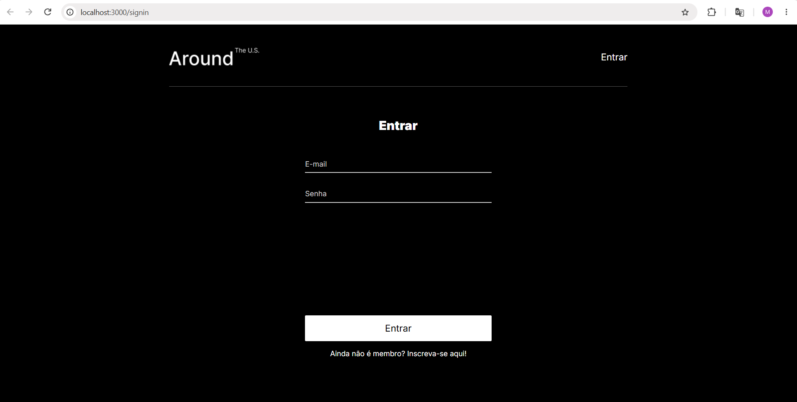
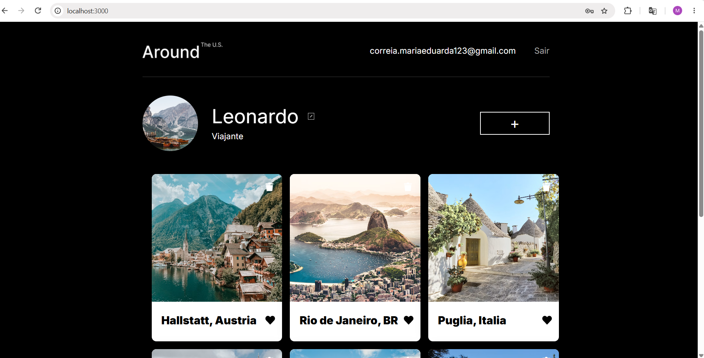

# Projeto Around

## Descrição

Aplicação web desenvolvida com React, Node.js e Express que permite visualizar e interagir com cartões de locais. O projeto possui cadastro, login e autenticação de usuários, além de gerenciamento de perfil e cartões.

## Tecnologias utilizadas

- React
- JavaScript
- JSX
- CSS
- Node.js
- Express.js
- MongoDB
- Mongoose
- React Router
- Vite
- REST API
- JWT
- Nginx
- HTTPS

## Funcionalidades

- Cadastro de usuários
- Login e logout
- Autenticação com JWT
- Rotas protegidas
- Edição de perfil e avatar
- Adição e exclusão de cartões
- Curtidas nos cartões
- Visualização de imagens em pop-ups
- Layout responsivo para desktop e mobile
- Tratamento de erros

## Deploy

Aplicação disponível em:

https://around-maria.chickenkiller.com

API:

https://api-around-maria.chickenkiller.com

## Capturas de tela

Página de login:

Página principal:

