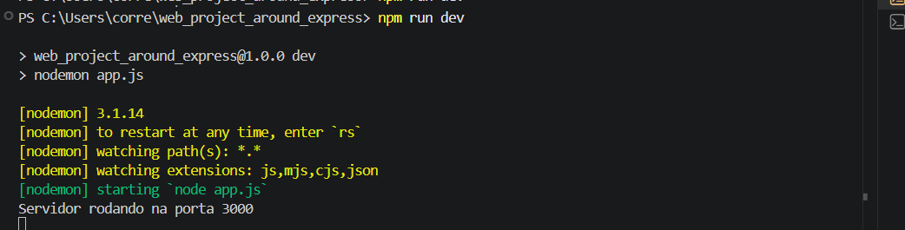
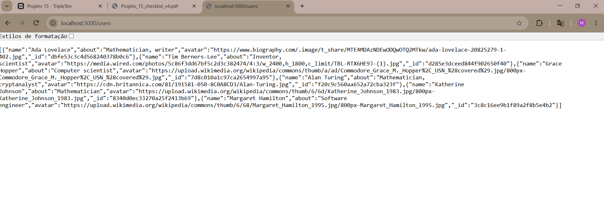

# Tripleten web_project_around_express

## Descrição

API desenvolvida com Node.js e Express que gerencia dados de usuários e cartões. O projeto possui rotas para consultar usuários, cartões e usuários por ID, além de tratamento de erros.

## Tecnologias utilizadas

- Node.js
- Express.js
- JavaScript
- Módulos `fs` e `path`
- Express Router
- ESLint (Airbnb-base)

## Funcionalidades

- GET `/users` — retorna usuários
- GET `/card` — retorna cartões
- GET `/users/:id` — retorna um usuário específico
- Tratamento de erros 404 e 500

## Capturas de tela

Servidor rodando com Nodemon:

Resposta da API de usuários:

